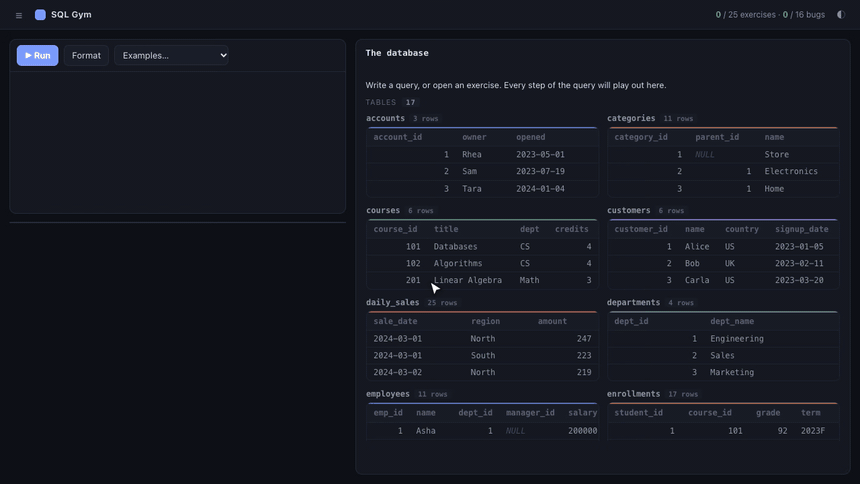
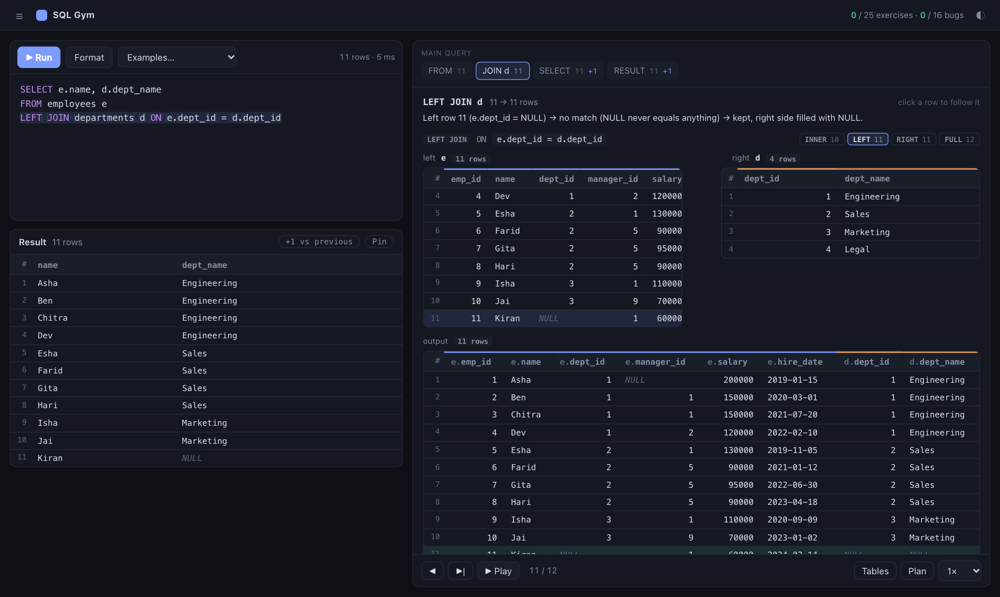
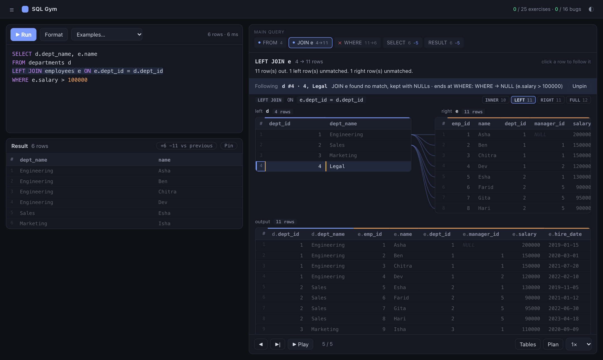
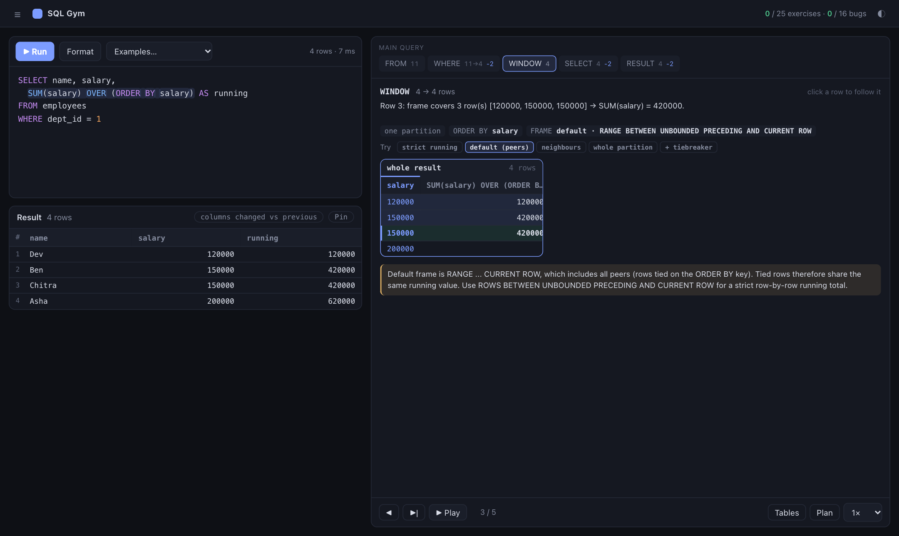
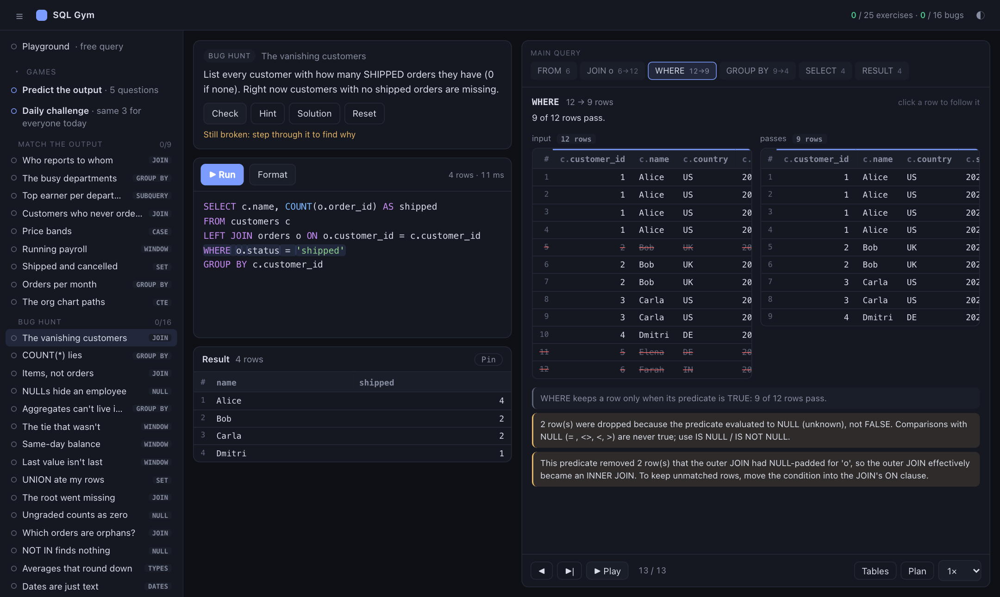

# SQL Gym

**See how SQL actually runs.** Type a query and watch it execute, step by step, with the real intermediate tables: which rows a JOIN matched, which a WHERE dropped (and why), how rows were grouped, which window frame each row saw.



Most SQL tutorials teach syntax. Few show *execution*: that a query runs `FROM → WHERE → GROUP BY → HAVING → WINDOW → SELECT → DISTINCT → ORDER BY → LIMIT` regardless of the order you wrote it, that `NULL = NULL` is not true, or that a `WHERE` on the right-hand table silently turns a `LEFT JOIN` into an `INNER JOIN`. SQL Gym makes those things visible, then lets you practice them.

It is a small, dependency-free local app: Python standard library on the server, vanilla JavaScript in the browser, SQLite underneath. No `pip install`, no build step, no CDN.

## Quick start

```bash
git clone https://github.com/KaustubhVatsa/sql-gym.git
cd sql-gym
python3 server.py          # opens http://127.0.0.1:8765
```

Requires Python 3.10+ (SQLite 3.39+ for `RIGHT`/`FULL JOIN`, which every current Python ships with) and a modern browser. The sample database is built automatically on first run. Node.js is only needed to run the frontend-logic tests.

Prefer the terminal? The original CLI still works: `python3 gym.py list | show N | check N | hint N | solution N | reset | ui`.

## What you can do

**Watch queries execute**
- Step or play through every stage: `FROM`/`JOIN` (match lines between rows, NULL-padding, drops), `WHERE` (per-row `TRUE`/`FALSE`/`NULL` verdicts), `GROUP BY` (buckets with the aggregate arithmetic), `HAVING`, window functions (partitions, frames, ties), `SELECT`, `DISTINCT`, `ORDER BY`, `LIMIT`.
- CTEs, recursive CTEs (one block per iteration), subqueries (including what a correlated subquery returned *for each row*), and `UNION`/`INTERSECT`/`EXCEPT`.
- **Follow a row.** Click any row to trace it forward ("why is Legal missing?") or backward ("which source rows built this result row?").
- **What-if diff.** After each edit, see `+2 −1 rows vs previous`, which rows changed, and per-stage row deltas. Pin a result as a baseline.
- **Join explorer.** See what `INNER`, `LEFT`, `RIGHT` and `FULL` would each return, and rewrite the join with one click.
- **Window sandbox.** Swap frames (`ROWS` vs the default `RANGE`), `RANK` vs `DENSE_RANK`, or add a tiebreaker, and watch the result change.
- **Query plan.** `EXPLAIN QUERY PLAN` with plain-English notes, next to the logical steps.
- **Gotcha detection.** Warnings for the classics: `LEFT JOIN` + `WHERE` trap, comparisons with `NULL`, join fan-out, `COUNT(col)` vs `COUNT(*)`, the default window frame with ties, `NOT IN` over a list containing `NULL`, integer division, non-ISO dates, a `LIMIT` that cuts through a tie, bare columns under `GROUP BY`.

**A pleasant editor**
- Tables used by your query appear instantly as you type, with every other table listed below; click one to complete a pending `JOIN` (including the `ON`).
- One-click SQL formatter, syntax highlighting, and the stage under your cursor is shown automatically.

**Practice**
- 25 graded exercises (joins, CTEs, window functions, interview-style mixes) with live pass/fail, hints and reference solutions.
- **Predict the output**: guess a row count or value, which join produced an output, or fill in a blank, then watch the query run. Includes a date-seeded daily challenge.
- **Bug hunt**: 16 broken queries to fix, using the visualizer as your debugger.
- **Match the output**: given only a target table, write the query that produces it.
- Practice datasets with deliberate gotchas: NULLs, orphan rows, ties, gaps, hierarchies.

Nothing leaves your machine. Your work is saved only as plain `answers/*.sql` files (plus a few UI preferences such as the theme in your browser's local storage). There are no accounts, scores or telemetry.

## Screenshots

| | |
|---|---|
|  |  |
| JOIN stage with match lines, join-kind counts and the live result | Following one row: kept by the LEFT JOIN, dropped at the WHERE |
|  |  |
| Window partitions and frames | Bug hunt: step through the broken query to find the bug |

## How it works

SQLite is the source of truth; the app never re-implements SQL semantics.

1. A small, structure-only parser (`engine/sqlparse.py`) splits a query into its logical phases. Expressions are never parsed, only clause boundaries.
2. Every table in `FROM` is wrapped as `(SELECT row_number() OVER () AS __rn, * FROM t)`, so each row has an identity.
3. Each phase is then **run as a real SQLite query** (`engine/trace.py`): the join chain, the `WHERE` predicate per row, the group keys and aggregates, each window function with its partition/order keys, and so on. The results become "stage" objects (tables plus row-identity links).
4. The browser (`static/js/viz.js`) renders those stages and animates them. Row lineage is a graph built purely from the stage data (`static/js/lineage.js`).

If a construct can't be broken down, the app degrades to showing the (still correct) result instead of guessing.

**Safety.** The server binds to `127.0.0.1` only, checks the `Host` header and JSON content type, opens SQLite read-only with an authorizer that allows only `SELECT`-class operations, and stops statements after a few seconds. It is a learning tool for your own machine, not a service to expose publicly.

## Testing

```bash
python3 tests/run_all.py
```

The suites do not just compare final results. They recompute what the UI *shows* independently:

- every exercise solution and 80 edge-case queries are traced in strict mode and must match SQLite's real output;
- window frames, group aggregates, join row counts, three-valued logic and sub-query results are recomputed from first principles;
- the join-kind counts are checked against real rewritten queries, and every window "Try" chip rewrite must trace cleanly;
- the row-lineage graph is verified exhaustively (no row vanishes without a recorded reason; plain output columns must equal the values in the source rows the graph claims they came from);
- the formatter is checked to change only whitespace and keyword case by executing before and after;
- every game question and bug-hunt challenge is validated against the database.

CI runs the suites on Python 3.10 and 3.12.

## Project layout

```
server.py          stdlib HTTP server and JSON API
gym.py             exercise list and CLI; builds the sample DB on first run
games.py           Predict questions, Bug hunt and Match-the-output content
seed.sql           core dataset (employees, orders, ...)
presets.sql        practice datasets
engine/
  sqlparse.py      tokenizer + clause-structure parser
  trace.py         runs each logical phase and builds the stage data
  frames.py        window specs and frame membership
  api.py, db.py    request glue; sandboxed read-only SQLite access
static/            the UI (vanilla ES modules, no build)
tests/             test suites (python3 tests/run_all.py)
```

## Adding content

- **Exercises:** append a tuple `(id, stage, prompt, hint, reference_solution, order_matters)` to `EX` in `gym.py`.
- **Predict / Bug hunt / Match:** add an entry to `games.py`; `tests/test_games.py` validates it against the database.

## Limitations

- Read-only: `SELECT`/`WITH`/`VALUES` only (by design).
- SQLite dialect, and each animated table is capped at 300 rows.
- `VALUES` lists are shown as plain results; row lineage is followed within one query block, not across a CTE boundary.
- Developed and tested in Chrome; other modern browsers should work but are untested.

## License

[MIT](LICENSE)
